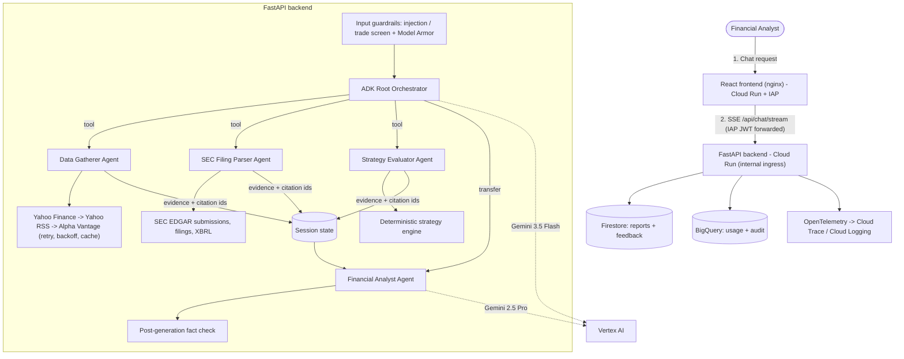

# Investment Analyst Agent

A multi-agent system for **MALIK LLC**'s analysts, built with **Google ADK, FastAPI, React and Cloud Run**. It fetches deterministic market data and SEC disclosures, evaluates investment strategies, and writes grounded investment briefs. Every number in a brief carries an inline citation and is fact-checked against the API output it came from.

> Implements the approved *Investment Analyst Agent* TDD and the GenAI co-build scope agreement (Sept 25, 2026). For the requirement-by-requirement mapping, see [Design traceability](#design-traceability). The previous single-agent / Project Aegis README is kept at [legacy/AEGIS_README.md](legacy/AEGIS_README.md).

---

## Architecture



**How a turn works**

1. The **input guardrails** run first, before any model call. They screen for prompt injection, credential extraction, trade-execution requests and oversized input, then call GCP Model Armor if it's configured.
2. The **Root Orchestrator** (Gemini 3.5 Flash) works out the tickers and intent, then calls the specialists it needs, in parallel:
   - **Data Gatherer**: quote, price history window, fundamentals, news.
   - **SEC Filing Parser**: filing index, 10-K/10-Q section text, 8-K, XBRL-reported financials.
   - **Strategy Evaluator**: deterministic Momentum, Value, Swing and Income signals.
3. Every tool result is stored in session state as **evidence**, keyed by a citation id such as `Q:NVDA`, `H:NVDA:5d`, `N:NVDA:2`, `SEC:NVDA:10-K:<accession>` or `S:NVDA:momentum`.
4. The orchestrator **transfers** to the **Financial Analyst** (Gemini 2.5 Pro). Its instruction receives the raw evidence under a strict grounding lock: use only the evidence, compute no new numbers, cite every claim. The brief streams to the UI token by token.
5. The **fact checker** pulls every figure out of the brief and checks it against the evidence, within the precision the figure was written to. The result goes back with the answer (`fact_check.accuracy`).
6. The report, prompt, citations, latency, tokens and prompt lineage are written to **Firestore**. Usage and audit rows go to **BigQuery**. Spans go to **Cloud Trace**.

## Repository layout

```text
├── investment-analyst/        # FastAPI + Google ADK backend (Python 3.11+)
│   ├── analyst/
│   │   ├── agents/            # ADK agent tree + guardrail callback
│   │   ├── api/               # FastAPI app, SSE streaming, IAP auth, schemas
│   │   ├── data/              # Yahoo / Alpha Vantage / SEC EDGAR adapters, fixtures, schemas
│   │   ├── guardrails/        # injection screen, Model Armor, fact checker
│   │   ├── prompts/v1/        # versioned prompts, loaded at runtime (PROMPT_VERSION)
│   │   ├── services/          # turn orchestration, Firestore store, BigQuery telemetry
│   │   ├── strategies/        # pure indicators + Momentum/Value/Swing/Income engine
│   │   ├── tools/             # ADK tools, evidence registry, retry/backoff/TTL cache
│   │   └── telemetry.py       # OTEL + Cloud Logging JSON formatter
│   ├── adk_agents/            # `adk web adk_agents` entrypoint
│   ├── evals/                 # golden dataset + LLM-as-a-Judge regression (`make eval-all`)
│   ├── tests/                 # pytest suite: mocked LLMs and APIs
│   └── Dockerfile
├── frontend/                  # React 18 + TypeScript + Tailwind + Vite, nginx container
├── terraform/analyst/         # Cloud Run, IAP, IAM, Secret Manager, Firestore, BigQuery, AR, Cloud Build
├── cloudbuild.yaml            # CI/CD: lint -> tests (>=80% cov) -> build -> push -> deploy
├── docs/API_CONTRACT.md       # backend <-> frontend <-> infra contract
├── docs/PRR_READOUT.md        # Sprint 6 product readiness review
├── Makefile
├── legacy/                    # previous single-agent / Project Aegis prototype + README
└── terraform/*.tf, aegis-service/, tests/   # Project Aegis gateway + benchmark harness (unchanged)
```

## Quick start (local)

```bash
make install-backend                    # creates ./.venv and installs requirements-dev.txt
make test-backend                       # pytest + coverage gate, no network or GCP needed

# Deterministic demo data (no market APIs). Still needs Vertex AI for the agents:
gcloud auth application-default login
cp investment-analyst/.env.example investment-analyst/.env   # set GOOGLE_CLOUD_PROJECT
make run-backend-offline                # or `make run-backend` for live market data
make run-frontend                       # http://localhost:5173 (needs Node 20, see frontend/README.md)
make adk-web                            # ADK developer UI on the same agent tree
```

Sample request:

```bash
curl -N -X POST localhost:8080/api/chat/stream -H 'Content-Type: application/json' \
  -d '{"message":"Give me a brief on NVIDIA'"'"'s performance this week and the latest news on their new chips","strategy":"momentum"}'
```

## Testing and evaluation

| Layer | Command | What it checks |
| --- | --- | --- |
| Unit and integration | `make test-backend` | Tools, provider fallback, retries/backoff, SEC parsing, indicator math, every strategy signal branch, fact checker, guardrails, auth, persistence, telemetry, and the real ADK agent tree driven by scripted fake LLMs through FastAPI and SSE. Coverage gate is 80%. |
| Frontend | `make test-frontend` | SSE parser, citation parsing, chat reducer, components (Vitest) |
| Golden regression | `make eval-all` | Real Gemini agents over deterministic historical fixtures. Gates: fact-check accuracy = 100%, tool recall ≥ 0.9, guardrail pass rate = 100%, TTFT p95 ≤ 6 s, and Gemini 3.5 Flash judge scores (faithfulness, explanation quality, thematic consistency, citation coverage, safety) averaging ≥ 4/5. Can load the dataset from BigQuery with `--bq-table`. |
| Infra | `make tf-validate` | `terraform fmt` and `validate` |

## Deployment

See [terraform/analyst/README.md](terraform/analyst/README.md). In short:

1. `cd terraform/analyst && cp terraform.tfvars.example terraform.tfvars`. Set `analyst_group_email` and check the network settings.
2. `terraform init && terraform apply`. The README explains how to bootstrap the first apply, before any images exist.
3. Add the Alpha Vantage key out of band: `gcloud secrets versions add alpha-vantage-api-key --data-file=-`.
4. Push to `main`, or run `gcloud builds submit --config cloudbuild.yaml`. Cloud Build lints, tests (≥ 80% coverage), builds, pushes and deploys both services.

## Design traceability

| TDD / scope requirement | Implementation |
| --- | --- |
| Separate deterministic data fetching from synthesis | `analyst/data/*` + `analyst/tools/*`. The analyst agent has no tools; it only sees recorded evidence. |
| Multi-agent orchestration (Data Gatherer, SEC Filing Parser, Strategy Evaluator, Financial Analyst) | `analyst/agents/__init__.py`. Specialists are ADK `single_turn` sub-agents exposed as tools; the analyst is reached through `transfer_to_agent`. |
| Yahoo Finance / Alpha Vantage with rate-limit handling | `data/market.py` fallback chain; `tools/resilience.py` handles 429/5xx/timeouts with exponential backoff, jitter and Retry-After |
| API response caching | `tools/resilience.cached`. TTL LRU cache: quotes 30 s, data 15 min, SEC 6 h. |
| SEC EDGAR 10-K/10-Q/8-K (plus proxy, Form 4, 13F listing) and XBRL | `data/sec_edgar.py`. Fair-access User-Agent and 10 req/s throttle. Section extraction never raises. |
| Momentum / Value / Swing / Income strategies | `strategies/engine.py`, deterministic thresholds with a rationale for each rule |
| Grounded citations | Evidence registry (`tools/evidence.py`), citation grammar in `docs/API_CONTRACT.md`, inline chips in the UI |
| Fact checks / 100% numeric accuracy | `guardrails/fact_check.py`, returned with each answer and gated in evals |
| Strict grounding lock, refuse unverified advice | `prompts/v1/financial_analyst.md`, `prompts/v1/orchestrator.md` |
| Model Armor / injection / jailbreak | `guardrails/model_armor.py` (prompt and response), `guardrails/injection.py`, ADK `before_model_callback` |
| Versioned prompts loaded dynamically | `analyst/prompts/<version>/`, `PROMPT_VERSION`, content hashes stored per report |
| Gemini 3.5 Flash routing, Gemini 2.5 Pro reasoning | `ANALYST_ROUTER_MODEL` / `ANALYST_REASONING_MODEL` |
| IAP / JWT AuthN, RBAC through Cloud Identity groups | `api/auth.py`; IAP on the frontend Cloud Run service with `iap.httpsResourceAccessor` for `analyst_group_email` |
| Custom service account, least-privilege IAM, Secret Manager | `terraform/analyst/iam.tf`, `secrets.tf` |
| OpenTelemetry + Cloud Trace, structured JSON logs with trace ids | `analyst/telemetry.py`; FastAPI and ADK spans |
| Token/cost and latency (TTFT) telemetry → BigQuery, audit trail | `services/telemetry_sink.py`, `terraform/analyst/bigquery.tf` |
| Feedback and report persistence (Firestore) | `services/report_store.py`, `POST /api/feedback`, thumbs and comment in the UI |
| pytest > 80% coverage with mocked LLM/API | `investment-analyst/tests/`, enforced in `cloudbuild.yaml` |
| LLM-as-a-Judge + golden dataset (`make eval-all`) | `investment-analyst/evals/` |
| React 18 / TS / Tailwind frontend | `frontend/` |
| Docker, Terraform, Cloud Build, Cloud Run | `*/Dockerfile`, `terraform/analyst/`, `cloudbuild.yaml` |

### Known gaps and decisions for the PRR

* **Per-agent identities.** All ADK agents run in one Cloud Run service, so they share `investment-analyst-sa`. Splitting them into separate services with their own SAs is documented in `terraform/analyst/README.md`.
* **Latency targets differ between the docs:** TDD p95 ≤ 6.0 s, scope < 4.0 s. The eval gate uses 6.0 s; tighten `GATES["ttft_p95_ms_max"]` in `evals/run_evals.py` once the target is agreed. TTFT measures the first streamed "thought" (the orchestrator's first tool call).
* **Model choice:** the defaults follow the TDD (2.5 Pro / 3.5 Flash). The earlier Aegis benchmarks used 3.1 Pro. You can swap models with environment variables, no code change.
* **Report history UI** is out of scope for V1, as the TDD says. Reports are still stored for audit and evals.
* **Sessions** default to in-memory, which is fine for one instance. Set `agent_engine_id` in Terraform (`SESSION_BACKEND=vertex`) or `SESSION_BACKEND=database` before scaling out.
* **Backend invoker IAM** is off by default. The backend relies on internal ingress plus IAP JWT checks. To turn it back on, set `frontend_attach_id_token = true` and `backend_invoker_iam_disabled = false`.

The full readiness review (Definition of Done scorecard, security review, runbook, risks) is in [docs/PRR_READOUT.md](docs/PRR_READOUT.md).
