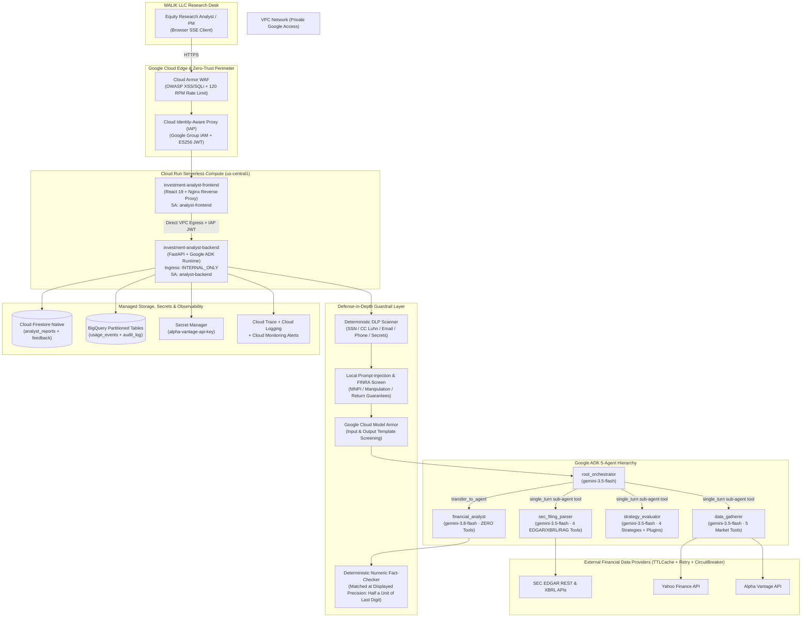
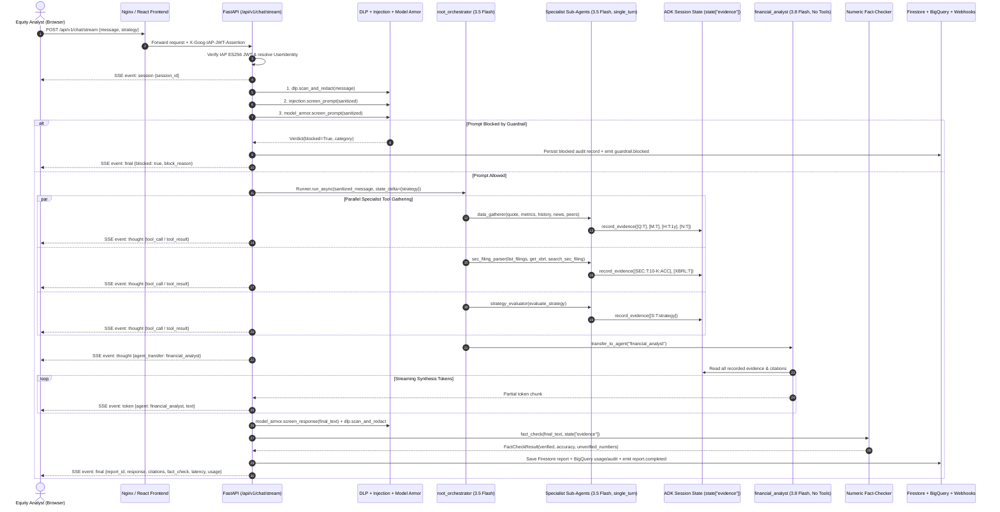
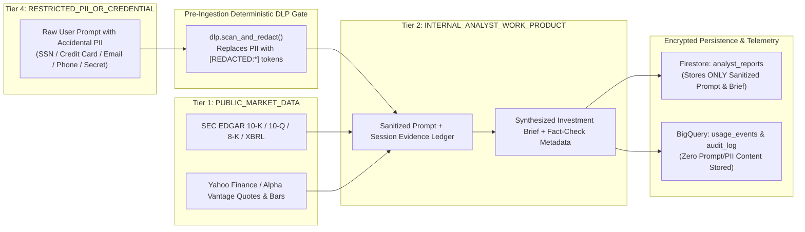
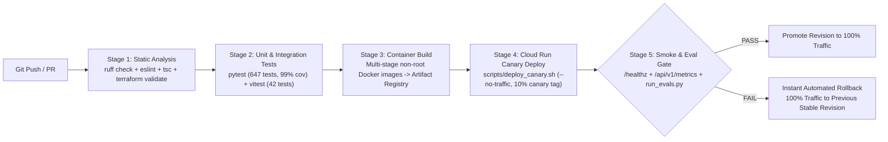

# System Architecture & Design Artifacts — Investment Analyst Agent

This document provides the complete system design artifacts for the **MALIK LLC Investment Analyst Agent**:
1. **System Context & GCP Infrastructure Architecture Diagram**
2. **Multi-Agent Cognitive Architecture & Sequence Diagram**
3. **Data Flow & Enterprise Data Classification Boundary Diagram**
4. **Resilience, Caching & Circuit-Breaker State Machine**
5. **CI/CD Pipeline & Canary Traffic Rollout Diagram**

---

## 1. GCP System Architecture & Zero-Trust Network Topology

---

## 2. Multi-Agent Turn Execution Sequence Diagram

---

## 3. Data Flow & Enterprise Data Classification Boundaries

All payloads traversing the system are tagged by [`analyst/guardrails/dlp.py`](../investment-analyst/analyst/guardrails/dlp.py) into four enterprise sensitivity tiers:

---

## 4. Resilience, Caching & Circuit-Breaker State Machine

Every external data provider (`yahoo`, `alpha_vantage`, `sec_edgar`) is protected by a per-provider [`CircuitBreaker`](../investment-analyst/analyst/tools/resilience.py) and LRU [`TTLCache`](../investment-analyst/analyst/tools/resilience.py):

```mermaid
stateDiagram-v2
    [*] --> CLOSED
    CLOSED --> CLOSED: Call succeeds (failure_count = 0)
    CLOSED --> CLOSED: Transient error < failure_threshold (3)\n(Retried via exponential backoff + jitter)
    CLOSED --> OPEN: Consecutive failures >= 3\n(Trips breaker; fallback provider invoked immediately)
    OPEN --> OPEN: Request arrives before recovery_timeout (30s)\nFast-fails with CircuitBreakerOpenError (< 0.1ms)
    OPEN --> HALF_OPEN: recovery_timeout (30s) elapsed
    HALF_OPEN --> CLOSED: Probe request succeeds\n(Reset failure_count = 0)
    HALF_OPEN --> OPEN: Probe request fails\n(Re-open for another 30s)
```

---

## 5. CI/CD Pipeline & Canary Traffic Rollout

