# FDE Capstone Rubric & Executive Readout — Investment Analyst Agent (MALIK LLC)

> **Customer**: MALIK LLC (Institutional Multi-Strategy Equity Research Desk)  
> **Engagement Type**: Forward Deployed Engineer (FDE) Capstone — Production-Grade Multi-Agent System on Google Cloud  
> **Target Grade**: **3 — Proficient (Strong Pass)** across every competency in **Section 1 (Presentation & Advisory Rigor)** and **Section 2 (Engineering & Implementation Excellence)**

---

## Executive Summary & Rubric Coverage Matrix

| Section | Competency Area | Target Level | Concrete Repository Evidence |
| :--- | :--- | :---: | :--- |
| **Part A.1** | **Strategic Delivery & Value Articulation** | **3 - Proficient** | Customer Personas, 5 Critical User Journeys (CUJs), Root-Cause Business Justification, and 10/50/250-Analyst **Total Cost of Ownership (TCO) & ROI Model** ([§A.1](#a1-strategic-delivery--value-articulation-personas-cujs--tco-model)) |
| **Part A.2** | **Objection Handling & Technical Defense** | **3 - Proficient** | 12-Scenario Executive & Panel Q&A Defense Matrix with quantitative latency/cost/accuracy trade-offs ([§A.2](#a2-objection-handling--technical-defense-qa-matrix)) |
| **Part A.3** | **Presentation Skills & Meeting Flow** | **3 - Proficient** | 30-Minute Time-Boxed Run-of-Show, Live Demo Script, Rabbit-Hole Deflection Playbook, and Intellectual Honesty Protocol ([§A.3](#a3-presentation-skills-pacing--run-of-show-guide)) |
| **Part A.4** | **AI-Driven Development Discussion** | **3 - Proficient** | Pre-coding Harness Architecture, In-the-Loop vs. Outside-the-Loop Autonomous Verification Loops, and 5 Post-Mortem Agent Mistakes Encoded into [`AGENTS.md`](../AGENTS.md) ([§A.4](#a4-ai-driven-development-harness--continuous-instruction-refinement)) |
| **Part A.5** | **Futures / Progressive GCP Roadmap** | **3 - Proficient** | 3-Phase Enterprise Evolution Roadmap mapping customer production unlocks to native Google Cloud services ([§A.5](#a5-futures--progressive-google-cloud-roadmap)) |
| **Part B — AI/ML 1** | **Agentic & Multi-Agent Systems** | **3 - Proficient** | Hierarchical 5-agent Google ADK architecture ([`analyst/agents/__init__.py`](../investment-analyst/analyst/agents/__init__.py)), tool-less synthesis invariant, session evidence ledger ([`analyst/tools/evidence.py`](../investment-analyst/analyst/tools/evidence.py)), provider failover + circuit breakers ([`analyst/tools/resilience.py`](../investment-analyst/analyst/tools/resilience.py)) |
| **Part B — AI/ML 2** | **Retrieval & Data Engineering for AI** | **3 - Proficient** | Complex SEC HTML `<table>` to GFM Markdown parser, section-aware overlapping chunker, Hybrid Okapi BM25 + Dense Vector (`text-embedding-005` / deterministic L2 feature hashing) Reciprocal Rank Fusion (RRF), and IR metrics (`Precision@K`, `Recall@K`, `MRR`, `nDCG@K`) in [`analyst/data/rag.py`](../investment-analyst/analyst/data/rag.py) and [`search_sec_filing`](../investment-analyst/analyst/tools/sec_tools.py) |
| **Part B — AI/ML 3** | **Model Selection, Tuning & Optimization** | **3 - Proficient** | Tiered Gemini 3.5 Flash (`orchestrator` + 3 specialist tool-callers) + Gemini 3.8 Flash (`financial_analyst`), versioned SHA-256 prompt registry ([`analyst/prompts/__init__.py`](../investment-analyst/analyst/prompts/__init__.py)), structured Pydantic schemas ([`analyst/data/schemas.py`](../investment-analyst/analyst/data/schemas.py)), and per-turn token cost estimation ([`analyst/config.py`](../investment-analyst/analyst/config.py)) |
| **Part B — AI/ML 4** | **LLM Ops and Evaluation** | **3 - Proficient** | Deterministic numeric fact-checker ([`analyst/guardrails/fact_check.py`](../investment-analyst/analyst/guardrails/fact_check.py)), Tool & Citation Precision/Recall/F1, ROUGE-1/2/L & smoothed BLEU-4, Gemini Flash LLM-as-a-Judge, automated `--baseline` regression gates ([`evals/run_evals.py`](../investment-analyst/evals/run_evals.py)), and OpenTelemetry Cloud Trace + BigQuery sinks ([`analyst/telemetry.py`](../investment-analyst/analyst/telemetry.py)) |
| **Part B — AI/ML 5** | **Domain-Applied AI/ML Expertise** | **3 - Proficient** | Deterministic financial indicators ([`analyst/strategies/indicators.py`](../investment-analyst/analyst/strategies/indicators.py)), 4 institutional strategy engines + plugin registry ([`analyst/strategies/engine.py`](../investment-analyst/analyst/strategies/engine.py)), SEC XBRL normalization ([`analyst/data/sec_edgar.py`](../investment-analyst/analyst/data/sec_edgar.py)), and FINRA Rule 2210 / 3110 / SEC Reg S-P compliance & DLP redaction ([`analyst/guardrails/dlp.py`](../investment-analyst/analyst/guardrails/dlp.py)) |
| **Part B — Scoping 1–4** | **Scoping & Documentation** | **3 - Proficient** | Problem Definition, Technical Scope & Constraints, Stakeholder Alignment, Architecture Diagrams ([`docs/ARCHITECTURE.md`](ARCHITECTURE.md)), ADRs ([`docs/ADR.md`](ADR.md)), and OpenAPI 3.1 contract ([`docs/API_CONTRACT.md`](API_CONTRACT.md), [`docs/openapi.json`](openapi.json)) |
| **Part B — Security 1–3** | **Systems Integration & Security** | **3 - Proficient** | API v1 versioning (`/api/v1/*`), Cloud IAP JWT verification ([`analyst/api/auth.py`](../investment-analyst/analyst/api/auth.py)), least-privilege dedicated service accounts ([`terraform/analyst/iam.tf`](../terraform/analyst/iam.tf)), Cloud Armor WAF ([`terraform/analyst/network_security.tf`](../terraform/analyst/network_security.tf)), Dual-Layer Prompt Injection + Model Armor + DLP Redaction |
| **Part B — Change 1–3** | **Designing for Change** | **3 - Proficient** | Runtime Feature Flags ([`analyst/config.py`](../investment-analyst/analyst/config.py)), Strategy Plugin Registry ([`analyst/strategies/engine.py`](../investment-analyst/analyst/strategies/engine.py)), HMAC-Signed Event-Driven Webhook Dispatcher ([`analyst/services/webhooks.py`](../investment-analyst/analyst/services/webhooks.py)), and Dev/Staging/Prod Terraform parity (`terraform/analyst/environments/*.tfvars`) |
| **Part B — Prod 1–3** | **Production Readiness & Operational Excellence** | **3 - Proficient** | 99% backend test coverage across 648 tests, concurrent SLA load benchmark ([`scripts/load_test.py`](../investment-analyst/scripts/load_test.py)), Cloud Monitoring SLA alerts ([`terraform/analyst/monitoring.tf`](../terraform/analyst/monitoring.tf)), Canary Rollout & Rollback script ([`scripts/deploy_canary.sh`](../scripts/deploy_canary.sh)), DR Snapshot Export/Restore, and Day-2 Runbook ([`docs/OPERATIONS_RUNBOOK.md`](OPERATIONS_RUNBOOK.md)) |

---

# Part A: Presentation & Advisory Rigor

## A.1 Strategic Delivery & Value Articulation (Personas, CUJs & TCO Model)

### 1. The Root Business Problem (Why This Is Not a "Science Project")
At **MALIK LLC**, equity research analysts cover 40–60 tickers across four investment styles (Momentum, Value, Swing, Income). Prior to this engagement, preparing a first-pass pre-earnings or initiation brief required **2.5 to 4 hours per ticker** of manual data assembly:
1. Pulling live quotes, 52-week ranges, and 1-year OHLCV bars from market terminals.
2. Computing technical and fundamental indicators (50/200-day SMAs, RSI-14, Bollinger %B, MACD histogram, ATR-14, P/E, PEG, FCF yield, 5-year dividend CAGR).
3. Locating the latest SEC 10-K/10-Q/8-K on EDGAR, extracting Item 1A (Risk Factors) and Item 7 (MD&A) financial tables, and reconciling GAAP XBRL line items.
4. Synthesizing a house-style investment brief with inline audit citations for the Investment Committee.

**Why off-the-shelf chatbots failed MALIK LLC**:
- **Hallucinated arithmetic**: Generic LLMs invent P/E ratios, miscalculate RSI/MACD, or cite stale training-cutoff revenue numbers. In a FINRA-regulated research desk, a single unverified number invalidates the entire memo.
- **Unstructured SEC HTML tables**: Standard text-stripping destroys multi-column segment revenue tables in 10-K filings.
- **No audit lineage**: Compliance requires every factual claim to map to a verifiable citation ID (`[Q:NVDA]`, `[XBRL:NVDA]`, `[SEC:NVDA:10-K:0001045810-26-000021]`) persisted in an immutable audit log.

### 2. Customer Personas & Critical User Journeys (CUJs)

| Persona | Role & Pain Point | Critical User Journey (CUJ) | Measurable Operational Impact |
| :--- | :--- | :--- | :--- |
| **Maya Lin** — *Senior Equity Research Analyst* | Covers 45 semiconductor & software names; spends 65% of her day copying XBRL numbers and 10-K risk paragraphs into memos. | **CUJ-1 (Deep-Dive Ticker Brief)** & **CUJ-2 (SEC 10-K Hybrid RAG Table Extraction)**: Asks *"Brief me on NVDA under a momentum lens and highlight Item 1A supply-chain concentration risks."* Watches live SSE agent thoughts, inspects inline `[XBRL:NVDA]` and `[SEC:...]` citations, and exports a verified Markdown brief in **< 18 seconds**. | Reduces first-pass memo assembly from **180 minutes to < 5 minutes** (97% time reduction), freeing analysts for primary channel checks and management calls. |
| **David Park** — *Multi-Strategy Portfolio Manager* | Needs rapid, apples-to-apples comparisons across Momentum, Value, Swing, and Income mandates before market open. | **CUJ-3 (Multi-Ticker Strategy Comparison)** & **CUJ-4 (Multi-Turn Follow-Up)**: Selects the `Value` or `Income` strategy pill, compares `AAPL vs. MSFT vs. KO`, and asks follow-up questions in the same ADK session without re-fetching cached market data. | Increases daily pre-market screening throughput by **5x** with 100% deterministic, rule-based strategy scoring. |
| **Elena Rostova** — *Chief Compliance & Risk Officer (CCO)* | Accountable for FINRA Rule 2210/3110 supervisory review, SEC Reg S-P PII protection, and AI model governance. | **CUJ-5 (Supervisory Audit, Fact-Check Verification & Guardrail Enforcement)**: Reviews the `FactCheckResult` badge (`100% verified`), inspects Firestore report lineage (`prompt_version`, SHA-256 prompt fingerprint, DLP redaction metadata), and audits BigQuery usage/security logs. | **Zero unverified numeric claims** reach the UI without an explicit warning flag; **100% of PII/credentials** are deterministically redacted before LLM invocation and storage. |

### 3. Total Cost of Ownership (TCO) & Return on Investment (ROI) Model

#### Token Economics per Analyst Turn (Tiered Gemini 3.5 Flash + Gemini 3.8 Flash Architecture)
> **Pricing Note**: The token-cost table below reflects **Gemini 3.8 Flash** (`$0.30/1M` input, `$2.50/1M` output) paired with **Gemini 3.5 Flash** (`$0.15/1M` input, `$0.60/1M` output). For conservative budgeting, `estimate_turn_cost_usd()` also supports a Pro-tier ceiling rate (`$1.25/1M` input, `$10.00/1M` output = `$0.021140/turn`, `$196.77–$3,914.75/mo` TCO ceiling across 10–250 seats), to be reconciled against BigQuery `analyst_telemetry.usage_events` actuals.

| Component per Full Research Turn | Model / Service | Avg Input Tokens | Avg Output Tokens | Unit Rate (Vertex AI List) | Cost per Turn (USD) |
| :--- | :--- | ---: | ---: | :--- | ---: |
| `root_orchestrator` + 3 Specialist Agents (`data_gatherer`, `sec_filing_parser`, `strategy_evaluator`) | `gemini-3.5-flash` | 9,500 | 1,400 | $0.15/1M in · $0.60/1M out | **$0.002265** |
| `financial_analyst` (Final Grounded Synthesis) | `gemini-3.8-flash` | 5,500 | 1,200 | $0.30/1M in · $2.50/1M out | **$0.004650** |
| **Total LLM Inference Cost per Turn** | **Tiered Blend** | **15,000** | **2,600** | *vs. $0.021140 Pro-tier ceiling* | **$0.006915** |

#### Monthly Infrastructure & LLM TCO Across Desk Sizes (22 Trading Days / Month, 25 Turns / Analyst / Day)

| Cost Category | GCP Service | Small Desk (10 Analysts · 5,500 turns/mo) | Mid-Size Desk (50 Analysts · 27,500 turns/mo) | Institutional Desk (250 Analysts · 137,500 turns/mo) |
| :--- | :--- | ---: | ---: | ---: |
| **LLM Inference** | Vertex AI (`gemini-3.5-flash` + `gemini-3.8-flash`) | $38.03 *(ceiling: $116.27)* | $190.16 *(ceiling: $581.35)* | $950.81 *(ceiling: $2,906.75)* |
| **Compute (Backend + Frontend)** | Cloud Run (scale-to-zero in dev; min-instances=2 in prod) | $42.00 | $185.00 | $540.00 |
| **Document Persistence** | Cloud Firestore Native (`analyst_reports` + sessions) | $3.50 | $18.00 | $88.00 |
| **Analytics & Audit Warehouse** | BigQuery (`usage_events` + `audit_log` partitioned) | $2.00 | $9.50 | $45.00 |
| **Security & Edge Defense** | Cloud IAP + Secret Manager + Cloud Armor + Model Armor | $25.00 | $65.00 | $210.00 |
| **Observability** | Cloud Logging + Cloud Trace + Cloud Monitoring | $8.00 | $32.00 | $125.00 |
| **Total Monthly GCP TCO** | **All-In Run Rate** | **$118.53 / mo** *(ceiling: $196.77)* | **$499.66 / mo** *(ceiling: $890.85)* | **$1,958.81 / mo** *(ceiling: $3,914.75)* |
| **Monthly Cost per Analyst Seat** | — | **$11.85 / seat** *(ceiling: $19.68)* | **$9.99 / seat** *(ceiling: $17.82)* | **$7.84 / seat** *(ceiling: $15.66)* |
| **Analyst Time Saved (@ 1.5 hrs/day, $150/hr loaded)** | Productivity Value | $49,500 / mo | $247,500 / mo | $1,237,500 / mo |
| **Net ROI Multiple** | **Value / TCO** | **418x** *(ceiling: 251x)* | **495x** *(ceiling: 278x)* | **632x** *(ceiling: 316x)* |

---

## A.2 Objection Handling & Technical Defense Q&A Matrix

Below is the structured defense matrix for executive and technical panel pushback:

| # | Stakeholder / Panel Objection | Root Concern | Data-Backed Engineering Defense & Trade-Off Analysis |
| :-: | :--- | :--- | :--- |
| **1** | *"How can a regulated investment desk trust an LLM not to hallucinate revenue or P/E numbers?"* | Hallucination & regulatory liability (FINRA Rule 2210). | **Three structural controls**: (1) All math (SMAs, RSI, MACD, Bollinger %B, P/E, CAGR) is executed in deterministic Python ([`analyst/strategies/indicators.py`](../investment-analyst/analyst/strategies/indicators.py)), never by the LLM. (2) The synthesis agent (`financial_analyst`) has **zero tools** and receives only structured session evidence (`state["evidence"]`). (3) Every response passes through [`fact_check()`](../investment-analyst/analyst/guardrails/fact_check.py) before leaving the server, where every `$`, `%`, and multi-digit figure is **matched at the precision the number is displayed (half a unit of the last digit)** against tool outputs and surfaced via `FactCheckResult.accuracy` (`1.0` gate in CI). |
| **2** | *"Why use a 5-agent hierarchy instead of a single agent with all 9 tools attached?"* | Architectural complexity vs. reliability. | **Context isolation & hallucination prevention**: When a single agent has all 9 tools plus a 1,500-word synthesis rubric, tool-selection recall drops and models occasionally fabricate tool outputs mid-synthesis. By separating **parallel Flash tool-gatherers** (`data_gatherer`, `sec_filing_parser`, `strategy_evaluator` configured as ADK `mode="single_turn"` sub-agents exposed as tools) from a **tool-less `gemini-3.8-flash` writer** (`financial_analyst` via `transfer_to_agent`), we achieve **1.00 tool recall** on the golden eval suite while keeping synthesis strictly grounded on already-recorded evidence. |
| **3** | *"Why run all 5 agents in one Cloud Run process instead of 5 separate microservices over HTTP/gRPC?"* | Distributed systems overhead vs. latency SLA. | **Latency & operational simplicity (see [ADR-001](ADR.md))**: In-process ADK orchestration shares `session.state["evidence"]` with zero serialization hop, saving **150–400ms of network + IAM token overhead per sub-agent call** and avoiding partial distributed transaction states. If a future workload requires independent GPU scaling for a custom parser, the `mode="single_turn"` specialist sub-agent boundary allows extracting that single specialist to a remote A2A service without changing the orchestrator prompt. |
| **4** | *"Why tier `gemini-3.5-flash` and `gemini-3.8-flash` instead of using a Pro model for synthesis?"* | Latency SLA (`TTFT <= 6s`) vs. reasoning depth vs. cost. | **Measured benchmark superiority (see [ADR-002](ADR.md))**: In the 8-model, 7-scenario benchmark ([`tests/outputs/BENCHMARK_SCORECARD_gemini_3_8_flash.md`](../tests/outputs/BENCHMARK_SCORECARD_gemini_3_8_flash.md)), `gemini-3.8-flash` achieved **94.1% overall quality** (5.0/5 Financial Accuracy, 5.0/5 Factual Grounding) vs. **76.0%** on the baseline Pro model, while reducing mean latency from **15.56s to 11.26s**. On the live 10-case golden evaluation suite ([`evals/results/SCORECARD_20261105T223730Z.md`](../investment-analyst/evals/results/SCORECARD_20261105T223730Z.md)), the `gemini-3.5-flash` + `gemini-3.8-flash` architecture achieved a **p95 time-to-first-thought of 3.3s** (`3,321.3 ms`) with **all gates PASS** (`1.00` fact-check accuracy, `1.00` tool & citation recall, and `5.0/5.0` judge mean). |
| **5** | *"What happens during earnings season when Yahoo Finance rate-limits (HTTP 429) or SEC EDGAR slows down?"* | Upstream fragility & cascading failures. | **Four-tier resilience chain ([`analyst/tools/resilience.py`](../investment-analyst/analyst/tools/resilience.py) & [`analyst/data/market.py`](../investment-analyst/analyst/data/market.py))**: (1) Thread-safe LRU `TTLCache` absorbs repeat queries across analysts (quotes 30s, metrics/bars 900s, SEC filings 21600s). (2) `call_with_retry` applies exponential backoff + full jitter respecting `Retry-After`. (3) Per-provider `CircuitBreaker` (`CLOSED -> OPEN -> HALF_OPEN`) fast-fails a degraded provider after 3 consecutive failures so threads never pile up. (4) The live fallback chain is **Yahoo → Yahoo RSS (news) → Alpha Vantage**, with circuit breakers; offline fixtures are used **ONLY** when `ANALYST_OFFLINE_MODE=true`. |
| **6** | *"SEC 10-K filings contain massive HTML tables. Doesn't stripping HTML tags scramble segment revenue rows?"* | Retrieval corruption on complex financial documents. | **Table-preserving HTML parser + Hybrid RRF RAG ([`analyst/data/rag.py`](../investment-analyst/analyst/data/rag.py))**: Our `_HTMLTableParser` extracts `<table>/<tr>/<th>/<td>` grids and converts them into aligned GitHub-Flavored Markdown tables *before* stripping remaining tags. We then chunk on paragraph/table boundaries with overlap and rank chunks using **Reciprocal Rank Fusion (RRF)** over **Okapi BM25** (exact financial terms/tickers) + **Dense Vector Cosine Similarity** (`text-embedding-005` / L2 feature hashing). |
| **7** | *"How do you defend against prompt injection, jailbreaks, or an analyst accidentally pasting client PII into the chat?"* | Security, compliance (SEC Reg S-P), and reputational risk. | **Defense-in-depth pipeline**: (1) Pre-ingestion [`dlp.scan_and_redact()`](../investment-analyst/analyst/guardrails/dlp.py) deterministically redacts SSNs, Luhn-validated credit cards, account numbers, emails, phone numbers, and API keys *before* the prompt reaches Gemini, tagging the payload classification (`RESTRICTED_PII_OR_CREDENTIAL`). (2) Local regex screen ([`injection.py`](../investment-analyst/analyst/guardrails/injection.py)) blocks jailbreaks, insider-trading/MNPI requests, and return guarantees in `< 1ms`. (3) Google Cloud **Model Armor** screens both input prompts and output responses. |
| **8** | *"Should Model Armor fail open or fail closed if the regional Model Armor API experiences a transient outage?"* | Availability vs. security trade-off. | **Configurable fail-closed in production (`MODEL_ARMOR_FAIL_CLOSED=true`, see [ADR-005](ADR.md))**: Even if Model Armor is unreachable, our deterministic local guardrail (`injection.py`) and DLP scanner (`dlp.py`) execute in-process with zero external dependency. In regulated production, `MODEL_ARMOR_FAIL_CLOSED=true` guarantees no unscreened prompt reaches the model; in dev sandboxes, `false` preserves developer velocity while logging a high-severity warning. |
| **9** | *"Why didn't you fine-tune a custom model for financial analysis?"* | Model customization vs. maintenance burden. | **RAG + deterministic tools beat fine-tuning for live market facts**: Fine-tuning bakes static knowledge into weights (which goes stale every quarter) and does not fix arithmetic errors. By combining **prompt engineering + versioned SHA-256 system instructions + deterministic Python indicator engines + live SEC XBRL/EDGAR RAG**, we achieve 100% factual currency without maintaining a $10k+/quarter retraining pipeline. Distillation/tuning is reserved for Phase 3 once 50,000+ thumbs-up analyst reports are collected in Firestore. |
| **10** | *"What happens when Cloud Run autoscales from 2 to 10 instances mid-conversation? Does the user lose session state?"* | Stateful sessions on stateless serverless compute. | **Pluggable ADK `SessionService` ([`analyst/services/sessions.py`](../investment-analyst/analyst/services/sessions.py))**: In local/single-instance dev, `SESSION_BACKEND=memory` uses `InMemorySessionService`. In multi-instance production (`AGENT_ENGINE_ID` configured), `SESSION_BACKEND=vertex` delegates to `VertexAiSessionService` (Vertex AI Agent Engine managed sessions), ensuring multi-turn state and `state["evidence"]` persist seamlessly across Cloud Run instances. |
| **11** | *"How do you prevent a bad prompt change or model upgrade from silently degrading report quality in production?"* | LLM Ops & regression prevention. | **Automated CI Quality Gates + Baseline Regression Detection ([`evals/run_evals.py`](../investment-analyst/evals/run_evals.py))**: Every prompt version has a SHA-256 fingerprint logged on every report. `run_evals.py` evaluates 10 golden scenarios across deterministic metrics (`fact_check_accuracy == 1.0`, `tool_recall >= 0.90`, `tool_f1`, `citation_f1`, `ROUGE-1/2/L`, `BLEU-4`, `TTFT p95 <= 6000ms`), 5-axis Gemini Judge scores (`>= 4.0/5.0`), and `--baseline` regression comparison that fails the build if any metric drops by `> 2%`. |
| **12** | *"How can downstream portfolio or compliance systems react to generated reports without polling Firestore?"* | Enterprise extensibility & event-driven integration. | **HMAC-SHA256 Signed Webhook & Event Dispatcher ([`analyst/services/webhooks.py`](../investment-analyst/analyst/services/webhooks.py))**: Every completed turn or guardrail block emits a structured `WebhookEvent` (`report.completed`, `guardrail.blocked`) to in-process subscribers and optional outbound webhook endpoints signed with `X-Analyst-Signature: sha256=<hmac>`, enabling zero-code integration with Slack/Teams bots, compliance archives, or Pub/Sub bridges. |

---

## A.3 Presentation Skills, Pacing & Run-of-Show Guide

### 1. 30-Minute Panel Presentation Run-of-Show

| Time Window | Elapsed | Segment | Key Talking Points & Artifacts Shown | Pacing Checkpoint |
| :---: | :---: | :--- | :--- | :--- |
| **00:00 – 04:00** | 4 min | **1. Executive Hook, Personas & Root Business Problem** | Introduce MALIK LLC's 3-hour manual memo bottleneck and FINRA compliance risk. Walk through Personas (Maya, David, Elena) and why generic chatbots fail without deterministic math + XBRL grounding. Present the **$7.84/seat/month TCO & 495x ROI table**. | Must finish slide/section by **04:00**. |
| **04:00 – 10:00** | 6 min | **2. Live End-to-End Product Demo (CUJs 1–5)** | **Demo 1 (Happy Path)**: Run *"Brief me on NVDA with a momentum lens and summarize Item 1A supply-chain risks."* Highlight live SSE thought trace, strategy score badge, clickable `[XBRL:NVDA]` & `[SEC:NVDA:10-K:...]` citations, and `100% Fact-Checked` badge. **Demo 2 (Adversarial & DLP Guardrail)**: Submit a prompt containing a fake client SSN + insider trading request; show instant `< 5ms` block, zero tool execution, and DLP redaction in `/api/v1/metrics`. | Must transition to Architecture by **10:00**. |
| **10:00 – 16:00** | 6 min | **3. Technical Architecture, RAG & Model Tiering** | Walk through the C4 & Sequence diagrams in [`docs/ARCHITECTURE.md`](ARCHITECTURE.md): 5-agent ADK hierarchy, why `financial_analyst` has zero tools, Gemini 3.5 Flash + 3.8 Flash tiering, HTML-table-preserving Hybrid BM25+Vector RRF RAG ([`rag.py`](../investment-analyst/analyst/data/rag.py)), and 3-state `CircuitBreaker` provider failover. | Must transition to LLM Ops & AI Harness by **16:00**. |
| **16:00 – 20:00** | 4 min | **4. LLM Ops, AI-Driven Dev Harness & GCP Roadmap** | Show golden scorecard metrics (`fact_check_accuracy`, `tool_f1`, `ROUGE-L`, `BLEU`, LLM-as-a-Judge), explain the pre-coding harness (`AGENTS.md` + autonomous verification loop), and present the 3-Phase GCP Production Roadmap. | Conclude formal presentation at **20:00** sharp, leaving **10 full minutes for Panel Q&A**. |
| **20:00 – 30:00** | 10 min | **5. Interactive Panel Q&A & Technical Defense** | Use the 12-Scenario Q&A Matrix ([§A.2](#a2-objection-handling--technical-defense-qa-matrix)) and ADRs ([`docs/ADR.md`](ADR.md)) to defend trade-offs calmly with concrete numbers. | Hard stop at **30:00**. |

### 2. Tactical Pacing & Rabbit-Hole Deflection Playbook
- **Time-Check Anchors**: Keep a visible timer at **04:00**, **10:00**, **16:00**, and **20:00**. If a section runs within 60 seconds of its boundary, summarize the remaining point in one sentence and advance.
- **Tactful Rabbit-Hole Deflection Templates**:
  - *When asked a deep tangential question mid-demo*:  
    > *"That's a critical question on multi-region Firestore replication semantics. In short, we use `nam5` multi-region in `prod.tfvars` for 99.999% read/write availability. So I can show you the live guardrail and XBRL citation flow within our timebox, let's bookmark the active-active failover mechanics for the first two minutes of Q&A—or I can walk through [`docs/OPERATIONS_RUNBOOK.md`](OPERATIONS_RUNBOOK.md) right after."*
  - *When asked about an out-of-scope feature (e.g., automated order execution / FIX protocol)*:  
    > *"We deliberately scoped automated trade execution out of Phase 1 (`docs/ADR.md`) to keep the system outside FINRA discretionary brokerage licensing during the research desk rollout. In our Phase 3 roadmap, we expose HMAC-signed webhooks (`analyst/services/webhooks.py`) so the desk's existing Order Management System can consume signals with a human-in-the-loop approval gate."*
- **Intellectual Honesty Protocol**:
  - Never guess or fabricate a cloud quota, pricing figure, or regulatory clause. Use the explicit three-part response:
    1. **State what you know with certainty**: *"In our benchmark over the 10-case golden suite, `gemini-3.5-flash` + `gemini-3.8-flash` achieved 1.00 tool recall, 100% fact-check accuracy, and 5.0/5.0 Judge scores with a measured p95 TTFT of 3.3 seconds (`3,321.3 ms`)."*
    2. **Name the exact boundary of what is unverified**: *"I have not benchmarked whether Vertex AI's `text-embedding-005` batch quota in `europe-west4` requires a quota uplift above 1,500 QPM for concurrent 10-K backfills."*
    3. **Commit to a concrete follow-up action**: *"I will validate the regional RPM quota table in the Vertex AI console after this session and include the exact burst ceiling in the follow-up note."*

---

## A.4 AI-Driven Development Harness & Continuous Instruction Refinement

### 1. Pre-Coding Harness Architecture
Before writing application features, we established a deterministic **Agentic Engineering Harness** so both human engineers and coding agents operate within strict, automated guardrails:
1. **Architectural Constitution ([`AGENTS.md`](../AGENTS.md))**: Codifies non-negotiable invariants (agent hierarchy, tool-less `financial_analyst`, `@safe_tool` + `record_evidence` contract, raw unformatted numbers in Pydantic schemas, zero edits to legacy Project Aegis files).
2. **Deterministic Offline Market Fixtures ([`analyst/data/fixtures.py`](../investment-analyst/analyst/data/fixtures.py))**: Provides complete, realistic quotes, 260-bar price histories, financial metrics, dividends, SEC filings, and XBRL facts (`ANALYST_OFFLINE_MODE=true`) so tests and evaluations run deterministically in `< 30s` with zero external network flakiness.
3. **One-Command Verification Loop ([`Makefile`](../Makefile))**:
   - `make lint`: Runs `ruff check` (`E,F,W,I,UP,B,SIM,RUF,S` bandit security rules) + `eslint` + `tsc --noEmit`.
   - `make test`: Runs `pytest --cov=analyst --cov-fail-under=80` (achieving **99% line coverage** across 647 backend tests) + `vitest run` (42 frontend tests).
   - `make tf-validate`: Runs `terraform fmt -check -recursive && terraform init -backend=false && terraform validate`.
   - `make eval`: Runs [`evals/run_evals.py`](../investment-analyst/evals/run_evals.py) with hard CI quality gates and `--baseline` regression detection.

### 2. "In-the-Loop" vs. "Outside-the-Loop" Development Workflows

| Mode | When Used | How the Harness Governs Execution | Concrete Example in This Repo |
| :--- | :--- | :--- | :--- |
| **In-the-Loop** *(Interactive, Spec-Guided Feature Iteration)* | Designing domain rules, API contracts, security boundaries, and UI UX flows where rapid human-agent alignment prevents wasted work. | The engineer specifies a targeted slice referencing [`docs/API_CONTRACT.md`](API_CONTRACT.md) or [`AGENTS.md`](../AGENTS.md); the agent edits 1–2 modules and immediately runs `pytest <single_test_file>` in `< 3s`. | Tuning the deterministic DLP regexes in [`analyst/guardrails/dlp.py`](../investment-analyst/analyst/guardrails/dlp.py) so 18-digit SEC accession numbers (`0000320193-25-000079`) and dollar figures (`$130,497,000,000`) never trigger false-positive SSN or phone redactions. |
| **Outside-the-Loop** *(Goal-Driven Autonomous Loop)* | Implementing multi-file subsystems, comprehensive test suites, Terraform modules, and regression evaluations against a clear Definition of Done. | The agent takes a high-level goal and autonomously iterates in a closed loop: **Plan -> Implement -> `ruff check` -> `pytest --cov` -> `terraform validate` -> Fix failures -> Repeat** until all gates exit `0`. | Implementing the end-to-end Hybrid BM25+Vector RRF RAG pipeline ([`analyst/data/rag.py`](../investment-analyst/analyst/data/rag.py)), wiring [`search_sec_filing`](../investment-analyst/analyst/tools/sec_tools.py), updating tool registry assertions, fixing `StrategySignal` plugin validation, and verifying 99% coverage. |

### 3. Feedback Loop: How Agent/Harness Mistakes Were Incorporated Back into `AGENTS.md`
Every time an agent or harness made an error during development, we conducted a mini post-mortem and codified a permanent rule into [`AGENTS.md`](../AGENTS.md) and the test suite so the mistake could never recur:

| # | Mistake Observed During Development | Root Cause | Permanent Rule Added to [`AGENTS.md`](../AGENTS.md) & Test Guard |
| :-: | :--- | :--- | :--- |
| **1** | **Synthesis agent re-invoked tools and hallucinated intermediate numbers.** | Giving `financial_analyst` direct access to market tools caused it to make ad-hoc tool calls mid-paragraph and misquote earlier results. | **Invariant in `AGENTS.md`**: *"The `financial_analyst` sub-agent has **no tools** by design — it may only write from `state['evidence']`."* Enforced by `test_agents.py::test_financial_analyst_has_no_tools`. |
| **2** | **Pre-formatted string numbers (`"$128.50"`, `"12.5%"`) in tool outputs broke numeric fact-checking.** | String formatting rounded values before `fact_check()` could compare narrative claims against raw evidence. | **Invariant in `AGENTS.md`**: *"All numbers inside `data` must remain **raw `float`/`int`** (never formatted strings like `'$1.23M'`), with percentages in percent units (`12.5` = 12.5%)."* |
| **3** | **Aggressive DLP phone/SSN regexes false-positived on SEC accession numbers (`0000320193-25-000079`) and ISO dates (`2026-09-15`).** | Generic digit-group regexes matched substrings inside 10-2-6 digit EDGAR accession IDs. | **Invariant in `AGENTS.md` & `dlp.py`**: Added negative lookbehind/lookahead guards `(?<![\d\-])...(?![\d\-])` and Luhn checksum validation; enforced by `test_rubric_enhancements.py::TestDlpAndClassification`. |
| **4** | **Adding a custom strategy plugin caused `StrategySignal` Pydantic validation to fail.** | `StrategySignal.strategy` was hardcoded to `Literal["momentum", "value", "swing", "income"]` instead of consulting the strategy registry. | **Invariant in `AGENTS.md` & `schemas.py`**: Replaced static `Literal` with a `@field_validator("strategy")` delegating to `engine.is_registered_strategy(v)`, preserving strict rejection of unknown strings while allowing registered plugins. |
| **5** | **Ruff bandit rule `S106` flagged `redacted_token="[REDACTED:CREDIT_CARD]"` as a hardcoded password.** | Any keyword argument containing `token` triggers Bandit `S106` on string literals. | **Harness Rule in `AGENTS.md`**: Run `ruff check` with security rules (`S`) enabled after every edit and explicitly document intentional redaction placeholders. |

---

## A.5 Futures / Progressive Google Cloud Roadmap

We designed the current architecture with clean interfaces (`SessionService`, `ReportStore`, `Embedder`, `WebhookDispatcher`, `StrategyPlugin`) so MALIK LLC can progress from **Phase 1 (Field-Ready MVP)** to **Phase 3 (Global Regulated Production)** using native Google Cloud services without rewriting core agent logic:

```mermaid
flowchart LR
    subgraph P1["Phase 1: Field-Ready MVP (Current)"]
        A1["Cloud Run (Frontend + Backend)"]
        A2["Vertex AI Gemini 3.5 Flash + 3.8 Flash"]
        A3["In-Process Hybrid BM25 + Vector RRF RAG"]
        A4["Cloud IAP + Local DLP + Model Armor"]
        A5["Firestore Reports + BigQuery Telemetry"]
    end

    subgraph P2["Phase 2: Enterprise Desk Pilot (Days 30–60)"]
        B1["Vertex AI Agent Engine Managed Sessions"]
        B2["Vertex AI Search + Vector Search Index for 10-K/10-Q Corpus"]
        B3["Cloud DLP (Sensitive Data Protection API) + Cloud Armor WAF"]
        B4["Looker Studio FinOps & Fact-Check Executive Dashboard"]
        B5["Pub/Sub Event Bus for Earnings-Release Webhooks"]
    end

    subgraph P3["Phase 3: Regulated Global Production (Days 60–120)"]
        C1["VPC Service Controls (VPC-SC) + Private Service Connect"]
        C2["Cloud KMS CMEK on Firestore, BigQuery & GCS"]
        C3["SEC Rule 17a-4 WORM Archival in Cloud Storage (Locked Buckets)"]
        C4["Vertex AI Supervised Tuning / Distillation on 50k+ Rated Briefs"]
        C5["Multi-Region Active-Active Cloud Run + Global External ALB"]
    end

    P1 --> P2 --> P3
```

| Phase | Target Horizon | Customer Features Unlocked | Native Google Cloud Services Leveraged & Strategic Value |
| :--- | :---: | :--- | :--- |
| **Phase 1: Field-Ready MVP** *(Delivered Today)* | Day 1 | Real-time SSE multi-agent briefs, 4 deterministic strategies + plugin API, SEC XBRL & Hybrid RAG over live filings, 100% numeric fact-check badge, thumbs-up/down feedback loop. | **Cloud Run** (serverless scale-to-zero), **Vertex AI Gemini 3.5 Flash & 3.8 Flash**, **Cloud IAP** (zero-trust identity), **Model Armor**, **Firestore Native**, **BigQuery**, **Secret Manager**, **Cloud Trace & Monitoring**. |
| **Phase 2: Enterprise Desk Pilot** | Days 30–60 | Multi-year historical 10-K/10-Q/earnings-transcript corpus search across the S&P 500; persistent cross-device analyst workspaces; automated morning briefings triggered by 8-K filings; live desk FinOps dashboard. | **Vertex AI Agent Engine** (`SESSION_BACKEND=vertex` already wired in [`sessions.py`](../investment-analyst/analyst/services/sessions.py)), **Vertex AI Vector Search & `text-embedding-005`** (`VertexAIEmbedder` already wired in [`rag.py`](../investment-analyst/analyst/data/rag.py)), **Cloud Pub/Sub + Cloud Scheduler** (consuming [`webhooks.py`](../investment-analyst/analyst/services/webhooks.py) events), **Cloud Armor WAF** ([`network_security.tf`](../terraform/analyst/network_security.tf)), and **Looker Studio** on BigQuery. |
| **Phase 3: Regulated Global Production** | Days 60–120 | Full SEC Rule 17a-4 / FINRA Rule 3110 immutable supervisory sign-off workflow; proprietary buy-side house-style distillation; strict data-exfiltration perimeter for confidential portfolio holdings; 99.95% multi-region SLA. | **VPC Service Controls (VPC-SC)** (cryptographic data perimeter around Vertex AI, Firestore, and BigQuery), **Cloud KMS Customer-Managed Encryption Keys (CMEK)**, **Cloud Storage Bucket Lock (WORM)** for 7-year SEC 17a-4 retention, **Sensitive Data Protection (Cloud DLP)** inspection templates, and **Vertex AI Supervised Fine-Tuning / Context Caching** to distill `gemini-3.8-flash` briefs into a custom Flash checkpoint (cutting synthesis latency and cost by an additional 55%). |

---

# Part B: Engineering & Implementation Excellence — Detailed Evidence Guide

## B.1 AI/ML Engineering

### 1. Agentic & Multi-Agent Systems
- **Cognitive Architecture & CUJ Alignment** ([`analyst/agents/__init__.py`](../investment-analyst/analyst/agents/__init__.py)):
  - Root `root_orchestrator` (`gemini-3.5-flash`) decomposes user requests across three parallel-capable `mode="single_turn"` specialist sub-agents exposed as callable tools (`data_gatherer`, `sec_filing_parser`, `strategy_evaluator`) and transfers final synthesis to `financial_analyst` (`gemini-3.8-flash`) via `transfer_to_agent`.
  - `RunConfig(streaming_mode=StreamingMode.SSE, max_llm_calls=50)` and `asyncio.timeout(settings.agent_timeout_seconds)` prevent infinite reasoning loops and enforce enterprise latency SLAs.
- **Session Memory & State Management** ([`analyst/tools/evidence.py`](../investment-analyst/analyst/tools/evidence.py), [`analyst/services/sessions.py`](../investment-analyst/analyst/services/sessions.py)):
  - Every tool call writes structured evidence into `tool_context.state["evidence"][citation_id]`.
  - Session IDs are strictly server-minted and bound to the authenticated `user_id` (`TestSessions::test_other_users_session_not_reused`), preventing cross-tenant context leakage.
- **Resilient Tool Calling & Provider Failover** ([`analyst/tools/resilience.py`](../investment-analyst/analyst/tools/resilience.py), [`analyst/data/market.py`](../investment-analyst/analyst/data/market.py)):
  - Every tool is wrapped with `@safe_tool` (never raises uncaught exceptions to the LLM; returns structured `error_type`), `@cached` (`TTLCache`), `call_with_retry` (exponential backoff + jitter), and per-provider `CircuitBreaker` (`CLOSED -> OPEN -> HALF_OPEN`).

### 2. Retrieval & Data Engineering for AI
- **Complex SEC HTML Table Parsing** ([`analyst/data/rag.py`](../investment-analyst/analyst/data/rag.py)):
  - `extract_html_tables()` and `html_to_markdown_preserving_tables()` parse nested SEC EDGAR HTML `<table>` blocks into 2D grids and render them as GitHub-Flavored Markdown tables before stripping boilerplate HTML/iXBRL tags.
- **Section-Aware Chunking & Hybrid BM25 + Vector RRF Search** ([`analyst/data/rag.py`](../investment-analyst/analyst/data/rag.py), [`analyst/tools/sec_tools.py`](../investment-analyst/analyst/tools/sec_tools.py)):
  - `chunk_filing_section()` splits 10-K/10-Q sections on paragraph and sentence boundaries with configurable character overlap and deterministic chunk IDs (`SEC:TICKER:FORM:ACCESSION#chunk-N`).
  - `HybridFilingRetriever` combines **Okapi BM25** (`k1=1.5, b=0.75`) with **Dense Vector Cosine Similarity** (`VertexAIEmbedder("text-embedding-005")` with automatic fallback to `DeterministicEmbedder`) via **Reciprocal Rank Fusion (`rrf_k=60`)**.
  - `evaluate_retrieval_quality()` computes `precision_at_k`, `recall_at_k`, `f1_at_k`, `mrr` (Mean Reciprocal Rank), and `ndcg_at_k`.

### 3. Model Selection, Tuning & Optimization
- **Model Tiering & Empirical Benchmark Selection** ([`analyst/config.py`](../investment-analyst/analyst/config.py), [`tests/outputs/BENCHMARK_SCORECARD_gemini_3_8_flash.md`](../tests/outputs/BENCHMARK_SCORECARD_gemini_3_8_flash.md)):
  - `router_model = "gemini-3.5-flash"` for low-latency orchestration and tool calling; `reasoning_model = "gemini-3.8-flash"` for high-coherence financial synthesis (**94.1%** CIO Judge score and **11.26s** mean latency across 7 scenarios vs. **76.0%** and **15.56s** on the baseline Pro model).
  - `estimate_turn_cost_usd()` computes per-turn USD token cost and exposes cumulative spend on `/api/v1/metrics`.
- **Prompt Versioning & Structured Output Enforcement** ([`analyst/prompts/__init__.py`](../investment-analyst/analyst/prompts/__init__.py), [`evals/judge.py`](../investment-analyst/evals/judge.py)):
  - Prompts are stored in versioned directories (`analyst/prompts/v1/*.md`) with SHA-256 lineage hashes persisted on every report.
  - All tool payloads and LLM-as-a-Judge outputs (`JudgeScores` with `response_mime_type="application/json"`) enforce strict Pydantic schemas.

### 4. LLM Ops and Evaluation
- **Beyond LLM-as-a-Judge** ([`evals/run_evals.py`](../investment-analyst/evals/run_evals.py)):
  - Combines deterministic numeric verification (`fact_check_accuracy`), information-retrieval metrics (`tool_precision`, `tool_recall`, `tool_f1`, `citation_precision`, `citation_recall`, `citation_f1`), lexical overlap metrics (`ROUGE-1`, `ROUGE-2`, `ROUGE-L` LCS F1, smoothed `BLEU-4`), latency percentiles (`ttft_p95_ms`, `total_ms_p95`), 5-dimension Gemini Judge scores, and automated `--baseline` regression detection (`compare_with_baseline()`).
- **Observability & Human Feedback Loop** ([`analyst/telemetry.py`](../investment-analyst/analyst/telemetry.py), [`analyst/services/telemetry_sink.py`](../investment-analyst/analyst/services/telemetry_sink.py)):
  - OpenTelemetry spans (`analyst.turn`, `agent.<name>`, `tool.<name>`) correlate directly with Cloud Logging JSON entries via `logging.googleapis.com/trace` and stream usage/audit rows to BigQuery.

### 5. Domain-Applied AI/ML Expertise
- **Financial Feature Engineering & Deterministic Strategy Engines** ([`analyst/strategies/indicators.py`](../investment-analyst/analyst/strategies/indicators.py), [`analyst/strategies/engine.py`](../investment-analyst/analyst/strategies/engine.py)):
  - Pure-Python implementations of SMA, EMA, Wilder's RSI(14), MACD(12,26,9), Bollinger Bands(20,2), %B, Wilder's ATR(14), ROC, and CAGR powering 4 deterministic strategy evaluators (`momentum`, `value`, `swing`, `income`).
- **Regulatory Compliance (FINRA Rule 2210 / 3110, SEC Reg S-P)** ([`analyst/guardrails/dlp.py`](../investment-analyst/analyst/guardrails/dlp.py), [`analyst/guardrails/injection.py`](../investment-analyst/analyst/guardrails/injection.py)):
  - Blocks requests involving material non-public information (MNPI / insider trading), market manipulation, and guaranteed-return claims; redacts PII/credentials and classifies all data across 4 enterprise sensitivity tiers.

---

## B.2 Scoping, Security, Designing for Change & Production Readiness

All companion artifacts are maintained in `docs/` and `terraform/analyst/`:
- **Architecture & Sequence Diagrams**: [`docs/ARCHITECTURE.md`](ARCHITECTURE.md)
- **Architecture Decision Records (ADRs 001–008)**: [`docs/ADR.md`](ADR.md)
- **REST & SSE API Contract + OpenAPI 3.1 Spec**: [`docs/API_CONTRACT.md`](API_CONTRACT.md) & [`docs/openapi.json`](openapi.json)
- **Day-2 Operations, Canary Rollout & Disaster Recovery Runbook**: [`docs/OPERATIONS_RUNBOOK.md`](OPERATIONS_RUNBOOK.md)
- **Production Readiness Review (PRR)**: [`docs/PRR_READOUT.md`](PRR_READOUT.md)
